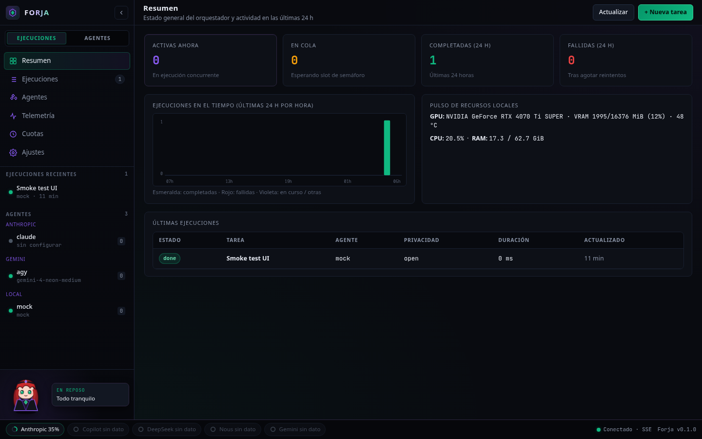

# Forja



Orquestador modular de agentes de código escrito en Rust. Lanza y supervisa tareas sobre worktrees de `git` aislados, aplica políticas de privacidad antes de ejecutar cualquier agente, persiste el historial en formato JSONL append-only y expone una API REST junto a un panel web local autocontenido.

## Inicio rápido

Requisitos: [Rust](https://rustup.rs) y `git`. Los agentes (`claude`, `opencode`, `agy`, `hermes`, `llm`) son opcionales; con `mock` puedes probar sin instalar nada.

```bash
git clone <url-del-repo> forja && cd forja
./install.sh            # compila e instala el binario `forja`
forja doctor            # revisa git, agentes instalados, repo y puerto
forja init              # asistente: agente del orquestador, modelos, perfiles ocultos

cd /ruta/a/tu-repo      # Forja detecta el repo y su rama actual solo
forja serve --open      # panel en http://127.0.0.1:7777
forja run --agent mock --privacy open "Crear archivo de prueba"
```

Sin instalar, desde el repo de Forja: `cargo run -p forja-cli -- doctor`.

### Ejecutar como app

Dos formas de abrir Forja sin dejar una terminal ocupada:

- **Carpeta en terminal**: `cd tu-repo && forja serve --open` (Forja detecta el repo y su rama; Ctrl+C para salir).
- **Lanzador de aplicaciones**: `forja init --desktop` (o `forja desktop install`) crea `~/.local/share/applications/forja.desktop` y copia el icono a `~/.local/share/icons/forja.webp`. Después busca **Forja** en el lanzador. `forja desktop uninstall` los quita. El lanzador ejecuta `forja app`, que también puedes usar desde la terminal.

`forja app` arranca `forja serve --repo <repo> --port <puerto>` en segundo plano solo si ese puerto no responde ya en `/api/health` (no duplica el servidor), espera a que conteste y abre el panel con `xdg-open`. `forja app --status` dice si está en marcha y `forja app --stop` lo detiene (solo mata el pid guardado si de verdad es un proceso `forja`). Si no hay repo configurado usa el repo git del directorio actual; fuera de uno te pide ejecutar `forja init`, que pregunta (o con `--yes` acepta) el repo por defecto de la app.

Dónde se guarda cada cosa (respeta `XDG_*` si están definidas):

| Qué | Ruta |
|---|---|
| Config de la app (`{"repo": "...", "port": 7777}`) | `$XDG_CONFIG_HOME/forja/app.json` o `~/.config/forja/app.json` |
| PID de `forja app` | `$XDG_STATE_HOME/forja/app.pid` o `~/.local/state/forja/app.pid` |
| Log del servidor | `$XDG_STATE_HOME/forja/forja.log` o `~/.local/state/forja/forja.log` |
| Lanzador e icono | `~/.local/share/applications/forja.desktop`, `~/.local/share/icons/forja.webp` |
| Ajustes del orquestador / historial | `.forja/store/` dentro del repo (ver `--store-dir`) |

El esfuerzo de razonamiento acepta alias en español (`alto`, `muy alto`, `máx`, `mínimo`...) y se guarda siempre como valor canónico (`high`, `xhigh`, `max`, `minimal`...). En opencode, si el modelo no tiene esa variante, la tarea se reintenta una vez sin ella y el registro queda sin esfuerzo.

### Qué hace cada comando

- `forja doctor`: diagnostica tu entorno y te dice qué falta (si no hay `settings.json`, te sugiere `forja init`; con `--fix` lanza el asistente al terminar).
- `forja app [--stop|--status]` y `forja desktop install|uninstall`: ver [Ejecutar como app](#ejecutar-como-app).
- `forja init [--yes] [--desktop]`: asistente de primer arranque, ver [Configuración inicial](#configuración-inicial-forja-init).
- `forja serve --open`: levanta el panel web local (solo accesible desde tu máquina).
- `forja run --agent AGENTE --privacy open|sensitive "tu tarea"`: ejecuta una tarea y muestra el resultado.
- `forja list`: historial de ejecuciones.

Cada tarea trabaja en un *worktree* (copia aislada) del repo en su propia rama `forja/...`; tu rama de trabajo no se toca hasta que tú decidas fusionar.

### Orquestador con voz

En el panel, pestaña **Orquestador**: conversas por texto o pulsas el icono de **micrófono** (junto a Enviar) para iniciar/terminar una llamada y hablar y que te responda en voz alta, como una llamada. Él delega el trabajo en los agentes de Forja y revisa el resultado antes de decirte que está listo.

- El «cerebro» es cualquiera de tus agentes: `hermes`, `claude`, `opencode`, `agy` o `local`. Se resuelve así: ajuste `orchestrator_agent` (panel → Ajustes) > variable `FORJA_ORCHESTRATOR_AGENT` > automático (el primero instalado en este orden: claude, opencode, agy, local, hermes). Cambiarlo en Ajustes se aplica en caliente y reinicia las sesiones.
- Con `hermes` mantiene sesión y eliges el perfil: ajuste `orchestrator_profile` > `FORJA_ORCHESTRATOR_PROFILE` > `default`. Los perfiles se **descubren** (`default` + subdirectorios de `$HERMES_HOME/profiles`, o `~/.hermes/profiles`); no hay nombres fijos.
- Con los demás agentes se hace una llamada one-shot a su CLI (mismo modelo que resuelves por agente en Ajustes) y, como esos CLIs no guardan sesión, Forja reenvía en cada mensaje las instrucciones del orquestador y los últimos 20 intercambios de la conversación.
- **Delegación sin permisos de shell.** Los orquestadores que no son Hermes (claude, opencode, agy, local) no ejecutan `curl`: terminan su respuesta con líneas de acción y **el servidor** las ejecuta por ellos. Formato exacto, una acción por línea y con el JSON en una sola línea: `[[forja:delegar {"titulo":"...","prompt":"...","agent":"opencode","privacidad":"open","modelo":"...","esfuerzo":"..."}]]` y `[[forja:estado ID]]`. Cada delegación pasa por las mismas validaciones que `POST /tasks` (agente, modelo, esfuerzo, política de privacidad), con un máximo de 5 delegaciones por turno. Esas líneas no se muestran al usuario. Cuando termina una tarea delegada, el servidor **despierta al orquestador con un turno automático** (ID, estado, salida y error resumidos, sin secretos) para que revise el resultado y continúe sin esperar a que el usuario escriba; si está hablando con el usuario espera a que termine, agrupa los resultados que acaben juntos y tras 8 turnos automáticos seguidos los deja como «Tareas delegadas» para el siguiente mensaje. Hermes conserva su `curl`, añadiendo `?conversation_id=` a `/tasks` para recibir el mismo aviso. JSON inválido, acciones rechazadas o el límite generan un aviso en el siguiente turno, nunca un error. Los bloques solo se interpretan en la salida del orquestador, jamás en la de las tareas (que se reinyecta neutralizada).
- Las tareas que el orquestador delega siguen la política de privacidad de siempre (`open`/`sensitive`); elegir otro agente de orquestador no la modifica.
- La voz usa el navegador (Web Speech API): funciona en Chrome, Edge y Chromium, necesita internet y permiso de micrófono.

### Orquestador, modelos y terminales en el panel

- **Conversaciones**: en **Orquestador** hay una lista lateral (máx. 20) con un historial independiente por conversación; varias pueden estar «pensando» a la vez. `+ Nueva` crea otra; ✕ la borra (con confirmación). La seleccionada se recuerda.
- **Comandos `/`**: al escribir `/` aparece el autocompletado. `/new` (conversación nueva), `/help`, `/rename <título>`, `/agents`, `/stop`; `/model <modelo>` y `/effort <nivel>` cambian el modelo y el esfuerzo del orquestador **en esa conversación** (sin argumento muestran el actual; `reset` vuelve a Ajustes); `/agent` sigue reservado.
- **Modelo y esfuerzo en el chat**: junto a Enviar hay dos desplegables compactos `[Modelo ▾] [Esfuerzo ▾]` y el icono de micrófono. Son **por conversación** (el servidor los guarda con ella y el panel los envía en el campo `modelo`/`esfuerzo` del chat), sobrescriben los Ajustes solo para ese orquestador y cambiarlos **no reinicia** la conversación. El de modelo lista los de la familia del orquestador (claude: sonnet/opus/haiku; el resto, lo que expone `/api/models`) más «otro…» de texto libre; el de esfuerzo muestra los niveles de esa familia y se oculta si no la soporta (`local`). Cambiar el agente del orquestador descarta estas elecciones.
- **Elegir orquestador, modelos y esfuerzo** (pestaña **Ajustes**; el selector de agente —y de perfil si es hermes— también está en la cabecera de Orquestador): agente del orquestador y perfil de Hermes (cambiarlos reinicia sus sesiones), perfiles de Hermes ocultos y, por agente, modelo (`claude`, `agy`, `opencode`, `hermes`, `local`; vacío = default; en hermes vacío = el del perfil) y esfuerzo de razonamiento (select con los niveles de cada familia; `local` y `mock` muestran «sin soporte»). En **Nueva tarea**, «Modelo» y «Esfuerzo» (opcionales) los sobrescriben para esa ejecución; el de esfuerzo cambia sus opciones con el agente y se deshabilita para `mock`/`local`.

### Esfuerzo de razonamiento

Prioridad igual que el modelo: **tarea** (`esfuerzo` en `POST /tasks`, `forja run --effort`) > **Ajustes** (`agent_effort`) > ninguno. Si no configuras nada **no se pasa ningún flag** (comportamiento de siempre). Cada familia tiene su conjunto de valores:

| Agente | Cómo se aplica | Valores |
| --- | --- | --- |
| `claude`, `agy` | `--effort <nivel>` | `low`, `medium`, `high`, `xhigh`, `max` |
| `hermes` | `hermes chat --reasoning <nivel>` (y `-m <modelo>` si fijas modelo) | `none`, `minimal`, `low`, `medium`, `high`, `xhigh`, `max`, `ultra` |
| `opencode` | `#variante` añadida al modelo (`provider/model#high`); un esfuerzo explícito reemplaza el `#` que ya traiga el modelo | texto libre `[a-z0-9_-]{1,20}` |
| `local`, `mock` | no soportado: se rechaza con un mensaje claro | — |

El esfuerzo efectivo queda en `RunRecord.effort` y `GET /api/agents` devuelve por agente `effort`, `effort_levels` (lista vacía = no soporta) y `model_editable`.
- **Terminales**: vista con 1–4 paneles que muestran en vivo la salida de varias ejecuciones a la vez (stderr en rojo, autoscroll que se pausa si subes, cancelar/limpiar/cerrar). Las tareas nuevas se abren solas en un panel libre.

### Configuración inicial (`forja init`)

`forja init` detecta los agentes instalados y te pregunta, con un valor por defecto que aceptas con Enter: qué agente orquesta, qué modelo y qué esfuerzo de razonamiento usar por agente (muestra el default del modelo; en el esfuerzo, Enter = sin configurar) y, si tienes Hermes, qué perfiles ocultar. Escribe `<store_dir>/settings.json` (por defecto `.forja/store/settings.json`) **fusionando** con lo que ya haya: no pisa otros campos, une los modelos y nunca quita perfiles ocultos. Al final imprime el comando para arrancar. `forja init --yes` no pregunta y acepta los defaults (también útil en scripts).

Todo es opcional: sin `settings.json` Forja funciona con defaults y elige el orquestador automáticamente. `settings.json` admite, además de los campos de siempre:

```json
{
  "orchestrator_agent": "claude",
  "orchestrator_profile": null,
  "agent_models": { "claude": "sonnet" },
  "agent_effort": { "claude": "high", "hermes": "medium" },
  "hidden_profiles": []
}
```

**Ocultar perfiles privados de Hermes.** Si algún perfil de Hermes no debe verse ni usarse desde Forja, añádelo a `hidden_profiles` (panel → Ajustes → «Perfiles de Hermes ocultos», o a mano en `settings.json`) o expórtalo en el entorno:

```bash
export FORJA_HIDDEN_PROFILES=privado,personal   # lista separada por comas
```

La lista efectiva es la unión de ambas. Un perfil oculto no aparece en las listas del panel ni de `/api/orchestrator/profile` y `/api/models`, no se puede elegir, y se rechaza en el orquestador y en el agente `hermes` (`forja run --agent hermes`) antes de ejecutar nada. El código no trae ningún nombre oculto de fábrica: la protección es tuya y está en tu configuración.

### Si algo falla

- `cargo: command not found`: instala Rust desde https://rustup.rs.
- `forja: command not found` tras instalar: añade `~/.cargo/bin` a tu `PATH`.
- Puerto ocupado: `forja serve --port 7788`.
- Un agente aparece como no instalado: instálalo o usa `--agent mock`.

Variables de entorno: `FORJA_ORCHESTRATOR_AGENT`, `FORJA_ORCHESTRATOR_PROFILE`, `FORJA_HIDDEN_PROFILES`, y `HERMES_HOME` (dónde buscar perfiles de Hermes; por defecto `~/.hermes`).

Los datos (historial y worktrees) se guardan en `.forja/` dentro de donde ejecutes el comando; está en `.gitignore`.

## Skills

Forja trae 15 skills genéricas (depuración sistemática, TDD, revisión previa al commit, simplificación, planes, spikes, GitHub/`gh`, inspección de repos, depuradores Python/Node, QA exploratorio, diagramas de arquitectura, delegación a sub-agentes) y dos propias: `forja-orquestador` (cómo delegar: agentes, privacidad `open`/`sensitive`, modelo y esfuerzo, bloques `[[forja:delegar ...]]` y API `/tasks`) y `forja-revision` (checklist para revisar el resultado de un agente).

**De dónde salen.** Se curaron a partir de las skills que usan los agentes del autor (Claude Code, OpenCode, Hermes, Agy): sin contenido personal ni de proyectos privados, solo con licencia que permite redistribuir (MIT). La tabla de procedencia (origen, autor, licencia) está en [`skills/README.md`](skills/README.md). Van **embebidas en el binario** (`build.rs` genera la tabla con `include_str!`, sin dependencias nuevas): para añadir o editar una skill, cambia `skills/<nombre>/SKILL.md` y recompila.

**Cada agente carga las suyas desde su propia carpeta**; Forja no las sirve en caliente, las copia ahí:

| Agente | Carpeta |
| --- | --- |
| `claude` | `~/.claude/skills` |
| `opencode` | `~/.config/opencode/skills` (o `$XDG_CONFIG_HOME/opencode/skills`) |
| `agy` | `~/.gemini/skills` (agy también lee `~/.agents/skills`, con menos prioridad) |
| `hermes` | `<HERMES_HOME base>/skills` para `default`, `<base>/profiles/<perfil>/skills` para otro perfil |

```bash
forja skills list                       # las incluidas
forja skills status                     # por agente instalado, cuáles ya están
forja skills install                    # DRY-RUN: muestra qué copiaría y dónde
forja skills install --yes              # copia (nunca sobrescribe sin --force, nunca borra)
forja skills install --agent hermes --profile uno --skill spike --yes
forja skills uninstall --yes            # solo quita lo que Forja instaló (marcador .forja-skill)
```

Opciones: `--agent` (claude, opencode, agy, hermes; por defecto todos los detectados), `--skill N` (repetible), `--profile P` (solo hermes; por defecto `default`), `--force` (actualiza una skill existente; nunca sigue enlaces simbólicos). `install` y `uninstall` son dry-run salvo `--yes`. Los perfiles de Hermes ocultos (`hidden_profiles` / `FORJA_HIDDEN_PROFILES`) se rechazan también aquí. `forja init` muestra el dry-run y pregunta si instalarlas (con `--yes` solo lo muestra).

## Arquitectura

```text
                       +-------------------+
                       |     forja-cli     |  (binario `forja`: run | list | serve)
                       +----+---------+----+
                            |         |
                            v         v
                  +---------------+  +-------------------+
                  | forja-server  |  |    forja-sched    |  (cola, semáforo N, reintentos, política)
                  | API REST + UI |->+---+---+---+---+---+
                  +---------------+      |   |   |   |
                                         |   |   |   +---------------------+
                         +---------------+   |   +----------+              |
                         v                   v              v              v
                 +--------------+    +------------------+  +-----------+  +------------+
                 |  forja-git   |    |   forja-agent    |  |forja-store|  | forja-core |
                 | (worktrees)  |    | Mock, Agy,       |  |  (JSONL)  |  |tipos/policy|
                 |              |    | Claude, OpenCode,|  |           |  |            |
                 |              |    | Hermes, Local    |  |           |  |            |
                 +------+-------+    +--------+---------+  +-----+-----+  +------------+
                        |                     |                |              ^
                        +---------------------+----------------+--------------+
```

Los seis adaptadores de `forja-agent` —`mock`, `agy`, `claude`, `opencode`, `hermes` y `local`— son funcionales: cada uno invoca su CLI (o el servicio local, en `local`) sin shell y devuelve `NotConfigured` solo si el binario o servicio no está instalado.

Para el detalle de cada crate y sus fronteras, consulta [docs/ARQUITECTURA.md](docs/ARQUITECTURA.md); el historial de desarrollo está en `docs/historial/`.

## Puerta de calidad

Ejecuta formato, `clippy` estricto (`-D warnings`) y toda la suite de pruebas (sin red ni gasto de saldo):

```bash
./scripts/check.sh
```

Compilación completa del workspace y prueba de extremo a extremo con `MockAgent`:

```bash
cargo build --workspace
cargo test -p forja-cli --test e2e
```

## Uso básico

Listar ejecuciones registradas (sale con código `0` cuando el store está vacío):

```bash
cargo run -p forja-cli -- list
```

Ejecutar una tarea con `MockAgent`:

```bash
cargo run -p forja-cli -- run --agent mock --privacy open --title "Demo" "Crear archivo de prueba"
```

Levantar la API REST y el panel web local (por defecto en `http://127.0.0.1:7777`):

```bash
cargo run -p forja-cli -- serve --port 7777
```

## Uso con `agy` real

Forja invoca el binario `agy` directamente mediante `tokio::process::Command` (nunca a través de una shell) pasando el prompt como argumento íntegro:

```bash
cargo run -p forja-cli -- --repo /ruta/al/repo --base-branch main \
  run --agent agy --privacy open --title "Refactor" "Explica el módulo principal"
```

### Política de privacidad

- `open`: permite todos los agentes: `agy`, `mock`, `claude`, `opencode`, `hermes` y `local` (cada uno requiere su CLI instalado; `forja doctor` te dice cuáles tienes).
- `sensitive`: solo permite `claude`. Cualquier intento de ejecutar otro agente con privacidad `sensitive` se rechaza con `ForjaError::PolicyDenied` antes de crear worktrees o iniciar procesos.
